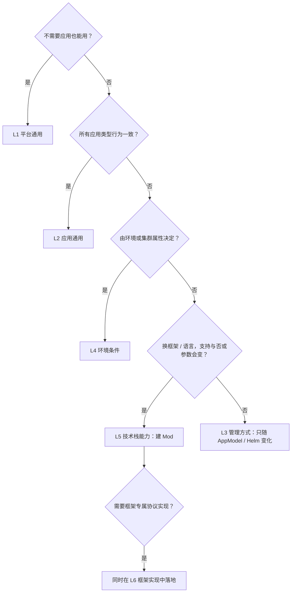

# BKMSApp 能力全景与分层

状态：已确认。

用途：把平台对应用提供的全部能力收集到一处，按"由什么决定能力是否可用"分层，用来判断新功能的归属和 ModSet 的边界。能力清单来自对 bkms-server 全部 41 个路由域的逐项梳理。

---

## 1. 分层依据

能力是否可用、怎么用，取决于下面五类因素之一。按因素由外到内分层：

| 层 | 决定因素 | 判断问题 | 代码归属 |
| --- | --- | --- | --- |
| L1 平台通用 | 与应用无关 | 不需要应用也能用吗？ | 各业务包，不动 |
| L2 应用通用 | 所有应用类型一致 | helm、trpc、taf、blank 行为都一样吗？ | 各业务包，不动 |
| L3 管理方式 | AppModel 或 Helm | 只在 AppModel 一侧或 Helm 一侧存在吗？ | `IsAppModelType` / `IsHelmBasedType` 判断 |
| L4 环境条件 | 环境或集群属性 | 由环境类型、是否联邦、集群组件决定吗？ | 按环境、集群判断 |
| L5 技术栈 | framework / language | 换一个框架或语言，支持与否或参数会变吗？ | `pkg/capability/*`（ModSet） |
| L6 框架实现 | 具体协议 | 某框架下具体怎么实现？ | `pkg/framework/*` |

**框架还是语言：** 以框架为主维度。目前的技术栈差异几乎都来自框架；语言只在两处起作用：
- 平台构建：Dockerfile 生成器按语言区分，目前只有 go。
- tRPC admin 配置键：同一框架下，不同语言的配置写法不同。

语言今后主要影响构建链路（构建镜像、工具链）。因此 L5 按框架组织，语言作为框架下的细分条件。

---

## 2. 总体架构图

```mermaid
flowchart TB
    subgraph L1["L1 平台通用（与应用无关）"]
        direction LR
        ws["空间 / 成员 / 权限 / 平台管理"]
        env["环境 / 特性环境 / 泳道"]
        audit["操作审计"]
        integ["集成接口：蓝盾 / BCS / BKCC / BKHCM / BSCP 查询"]
        depsvc["依赖服务（Redis）"]
        relstrat["发布策略（灰度 / 分批）"]
        rtimg["平台运行时镜像 / 自定义构建镜像"]
        compdef["组件定义"]
        dash["监控仪表盘 / 告警用户组"]
    end

    subgraph L2["L2 应用通用（所有应用类型）"]
        direction LR
        appcrud["应用 CRUD / 显示名 / 可见环境"]
        build["构建配置 / 构建记录 / 触发策略"]
        image["镜像：快照 / 晋级 / 删除"]
        cfgfile["配置文件体系：def / 版本 / overlay / BSCP 来源"]
        scopedenv["作用域环境变量"]
        alert["告警策略"]
        topo["资源拓扑 / WebConsole / 实例日志"]
    end

    subgraph L3["L3 管理方式"]
        direction LR
        subgraph AM["AppModel 基座（trpc / taf / blank 共享）"]
            amdeploy["部署：记录 / 快照 / 下架 / 状态 / 预检 / 总览"]
            render["工作负载渲染：规格 / 探针 / 生命周期 / 卷 / 副本 / Route ENI"]
            appspec["AppSpec 各 section"]
            inst["实例：扩缩容 / 批量删除 / 端口转发 / 事件"]
            comp["组件实例"]
            appenv["应用环境变量 / 内置变量"]
            plain["plain 配置文件"]
            autodeploy["一键构建部署"]
            polreg["北极星注册：CR / 权重 / 隔离 / 实例统计"]
            bscpinj["BSCP 注入（PodSpec）"]
        end
        subgraph HM["Helm 链路（helm / agones）"]
            chart["chart 来源 / values / 部署 / 回滚"]
            chartbuild["chart 构建 / 制品"]
            postrender["PostRenderer / Service 同步 / BSCP 注入"]
        end
    end

    subgraph L4["L4 环境条件"]
        direction LR
        gpa["GPA 自动扩缩容（非联邦）"]
        hostport["HostPort（仅联邦）"]
        addon["集群 addon 依赖"]
        portpool["端口池"]
    end

    subgraph L5["L5 技术栈能力（ModSet，pkg/capability）"]
        direction LR
        ff["frameworkFile"]
        dm["devMode"]
        ac["adminCommand"]
        apm["apmServiceName"]
        pol["polaris：serviceCheck / frameworkPatch"]
        bscp["bscpWorkloadMeta"]
        pb["platformBuild（框架 + 语言）"]
    end

    subgraph L6["L6 框架实现（pkg/framework）"]
        direction LR
        trpc["trpc：渲染插件 / YAML / 北极星补丁 / HTTP admin / telemetry 解析"]
        taf["taf：渲染插件 / conf 合并校验 / 私有 admin 协议 / XML 解析"]
        blank["blank：standard 插件"]
    end

    L1 --> L2 --> L3
    AM --> L4
    AM --> L5
    L5 --> L6
```

读法：上层不依赖下层；下层叠加在上层之上。L4、L5 只叠加在 AppModel 基座上，Helm 链路没有技术栈能力。

---

## 3. 技术栈能力矩阵（L5）

| 能力 | trpc + go | trpc + cpp | taf | blank | 维度 |
| --- | --- | --- | --- | --- | --- |
| frameworkFile | yaml | yaml | taf | — | 框架 |
| devMode | trpc 脚本集 | trpc 脚本集 | taf 脚本集 | — | 框架 |
| adminCommand | HTTP，嵌套键 | HTTP，平铺键 | 私有协议 | — | 框架 + 语言 |
| apmServiceName | YAML 解析 | YAML 解析 | XML 解析 | — | 框架 |
| polaris.serviceCheck | ✓ | ✓ | — | — | 框架 |
| polaris.frameworkPatch | ✓ | ✓ | — | — | 框架 |
| bscpWorkloadMeta | ✓ | ✓ | 未接入 | — | 框架 |
| platformBuild | ✓ | — | — | — | 框架 + 语言 |

Helm / Agones 全部不支持（`unsupported_app_type`）。

---

## 4. 新功能归属判断

只有走到 L5 的功能才进 ModSet；L6 是 L5 能力在具体框架下的实现，不单独建 Mod。

---

## 5. 分层约定

1. 分层依据为"由什么决定能力是否可用"。按产品菜单的划分只用于界面组织，不用于判断能力归属。
2. L4 环境条件单独成层，不并入管理方式。
3. 一键构建部署、北极星注册、BSCP 注入归 L3 AppModel 基座。今后若这些能力在不同框架或语言下出现差异，再建 Mod 移入 L5。
4. 新功能先按 §4 判断归属；只有 L5 进入 ModSet，L6 只做框架内的实现。
